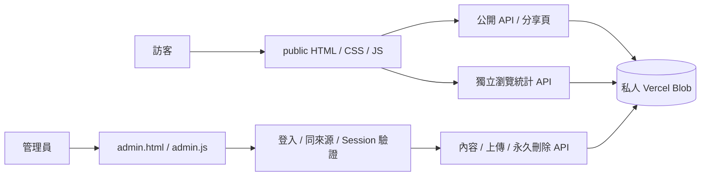

# 系統架構

## 技術與邊界

前端為原生 HTML、CSS、ES modules，沒有 React 或前端框架。`public/` 同時包含展示站與管理後台；Vercel 以單一 Node.js 24 Function 處理 API、媒體代理及分享頁。持久資料保存在私人 Vercel Blob，不依賴 Function 的暫存磁碟。

建置只打包兩個模組：`server/sanitizer.cjs`（伺服器 Markdown 清理器）及 `public/exif-reader.js`（瀏覽器 EXIF 解析器）。其餘前端檔案直接提供。



## 前端模組

| 檔案 | 職責 |
| --- | --- |
| `bootstrap.js` | 取得公開內容、載入應用、錯誤／重試、啟動統計 |
| `app.js` | 六個頁面、作品選取、文章閱讀、搜尋與內容填入 |
| `routes.js` | 新網址與舊 hash 路由解析 |
| `photo-viewer.js` / `photo-gestures.js` | 放大觀看、曝光資料覆蓋、背景與觸控判斷 |
| `photo-meta.js` / `client/exif-reader.js` | 六欄 EXIF 整理、顯示與原始檔讀取 |
| `photo-organization.js` | 批次欄位更新、單張與群組排序 |
| `admin.js` | 登入、編輯、壓縮上傳、保存、垃圾桶與設定 |
| `entry.js` / `motion.js` | 可略過開場、頁面切換、減少動態效果支援 |
| `theme.js` | 套用本機主題偏好 |
| `visits.js` | 瀏覽事件去重與個人頁統計顯示 |

桌面版共用頁首、固定左側導覽、相同寬度的輔助右欄與內容捲動區；800px 以下採文件流與底部導覽。首頁保留精選照片、直角玻璃字標及較薄的貫通資訊列。

## 內容形狀

`data/seed.json` 包含 `settings`、`photos`、`notes`、`friends`、`looks`。此備份的三種內容陣列均為空；設定為通用文案，只有六種內建色彩預設。

- `settings`：作者、網站名稱、頂部標題、描述、首頁主標題及介紹。
- `photos`：ID、網頁圖／縮圖、標題、分類、描述、署名、來源、六欄 EXIF、狀態及更新時間。
- `notes`：ID、標題、摘要、分類、Markdown、狀態、發佈日期及更新時間。
- `friends`：ID、名稱、HTTPS 網址、簡介、標籤及狀態。
- `looks`：程式內建的 CSS filter 預設；驗證保存時以 seed 中的設定為準。

內容驗證上限為照片、文章、友鏈各500筆，垃圾桶照片仍計入上限。照片與文章 ID 不因改標題而改變。

## 私人儲存路徑

```text
<prefix>/cms/content.json         CMS、認證版本與永久刪除狀態
<prefix>/media/<uuid>.<ext>       網頁圖及縮圖
<prefix>/history/<time>-<id>.json 保存前的內容修訂
<prefix>/analytics/visits.json    獨立統計及短期去重事件
<prefix>/security/login-<hash>.json 登入嘗試限制
```

`CONTENT_PREFIX` 優先決定前綴。未設定時：Vercel Preview 使用分支／部署資訊產生預覽前綴，其餘使用 `production`。本機服務會將空值及 `production` 改為 `development`。前綴是資料分區，完整環境隔離仍應使用不同 Blob 儲存庫和 token。

初次讀取尚未存在的 CMS 時，伺服器會建立空 seed。重新部署程式不會覆蓋已存在的 CMS。

## API 與路由

| 路徑 | 方法 | 存取與行為 |
| --- | --- | --- |
| `/api/content` | GET | 僅公開作品、文章與友鏈；文章經 Markdown 清理 |
| `/api/session` | GET | 回傳管理登入狀態 |
| `/api/login` | POST | 密碼驗證、嘗試限制、設定 Session cookie |
| `/api/logout` | POST | 清除目前瀏覽器 cookie |
| `/api/media?key=…` | GET | 公開作品可讀；其他媒體需有效管理 Session |
| `/api/admin/content` | GET / PUT | 管理內容及 ETag 修訂；保存前檢查版本 |
| `/api/admin/upload` | POST | 驗證圖片格式、大小，寫入私人 Blob |
| `/api/admin/preview` | POST | Markdown 清理與預覽 |
| `/api/admin/password` | POST | 驗證舊密碼、保存新雜湊、遞增認證版本 |
| `/api/admin/photos/purge` | POST | 帶確認文字及修訂的永久刪除流程 |
| `/api/visits` | GET / POST | 公開計數、事件記錄及去重 |
| `/photos/:id` / `/notes/:id` | GET / HEAD | 公開獨立頁與分享資訊；不可讀內容回404 |
| `/sitemap.xml` | GET / HEAD | 動態列出正式公開作品與文章 |

`api/router.js` 將請求交給 `server/handler.mjs`。所有非 GET 寫入都先驗證 Origin；管理操作另驗證 Session。大部分 API 內容使用 `no-store`；公開媒體可短暫快取300秒。

## 保存與並行保護

後台以完整內容及讀取時的 revision 保存。API 檢查 revision，產生私人歷史內容，再用 Blob ETag / `ifMatch` 比對寫入。衝突回409，後台要求重新載入，避免覆蓋另一分頁的新資料。

公開資料過濾草稿、封存及垃圾桶；管理狀態、認證及統計不會透過 `/api/content` 提供。歷史修訂只在私人儲存庫，沒有公開瀏覽介面。

## 圖片與永久刪除

瀏覽器先讀原始檔 EXIF，再產生長邊2000px網頁圖與480px縮圖。只保存相機、鏡頭、焦距、光圈、快門、ISO；不保存 GPS 或機身序號。網頁圖上傳限制約2MB；原圖留在管理者本機。

刪除先進垃圾桶；還原為草稿。永久刪除先保存刪除計畫、阻止相關還原與寫入，再清除未共用媒體，最後移除照片紀錄並保留清除標記。失敗保留可重試狀態，舊備份無法直接復活已清除媒體。任何文章（含草稿／封存）仍引用照片時會阻止刪除。

## 統計與認證

瀏覽統計與 CMS revision 分開。頁面開啟計一次，同一瀏覽器30秒內沿用事件ID；伺服器保留短期ID以處理重送。每日以 Asia/Taipei 跨日，累計不歸零。這是近似瀏覽次數，並非不重複訪客；已知爬蟲、DNT與GPC略過。

管理密碼採帶鹽 scrypt；Session 以 HMAC 簽章、有效8小時，使用 HttpOnly / SameSite=Strict，HTTPS 加 Secure。改密碼遞增版本，使其他舊 Session 失效。登入限制另外儲存 IP 的簽章值，統計本身不保存 IP。
